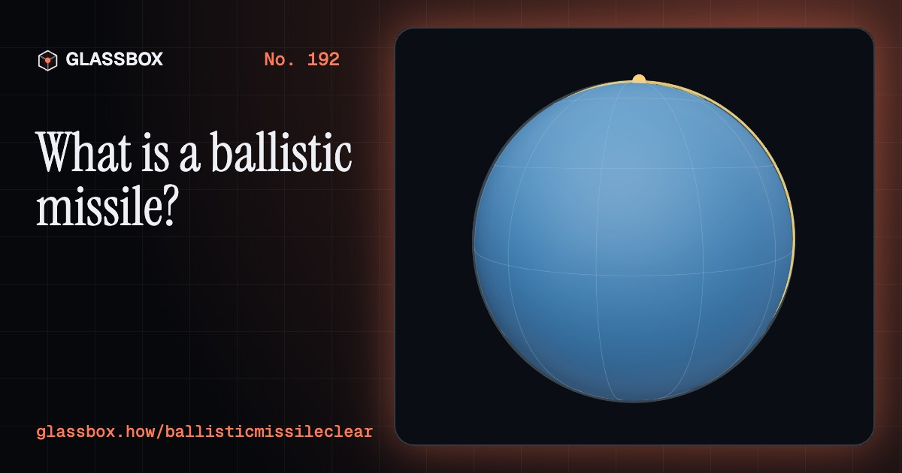
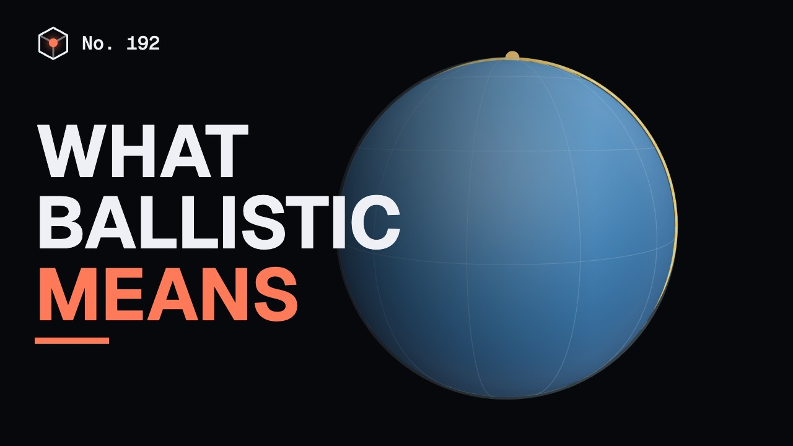
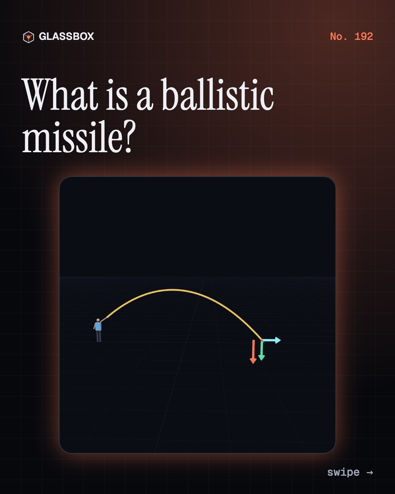
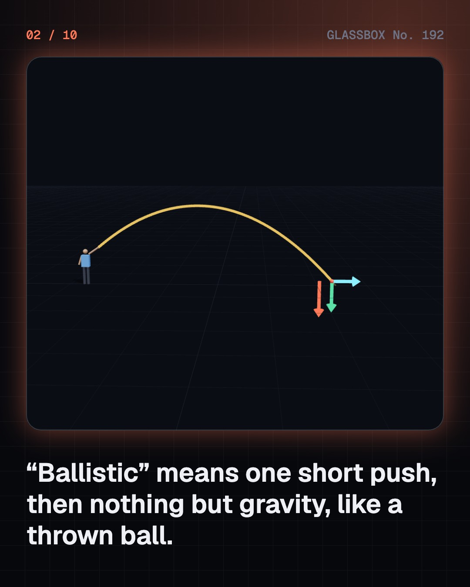
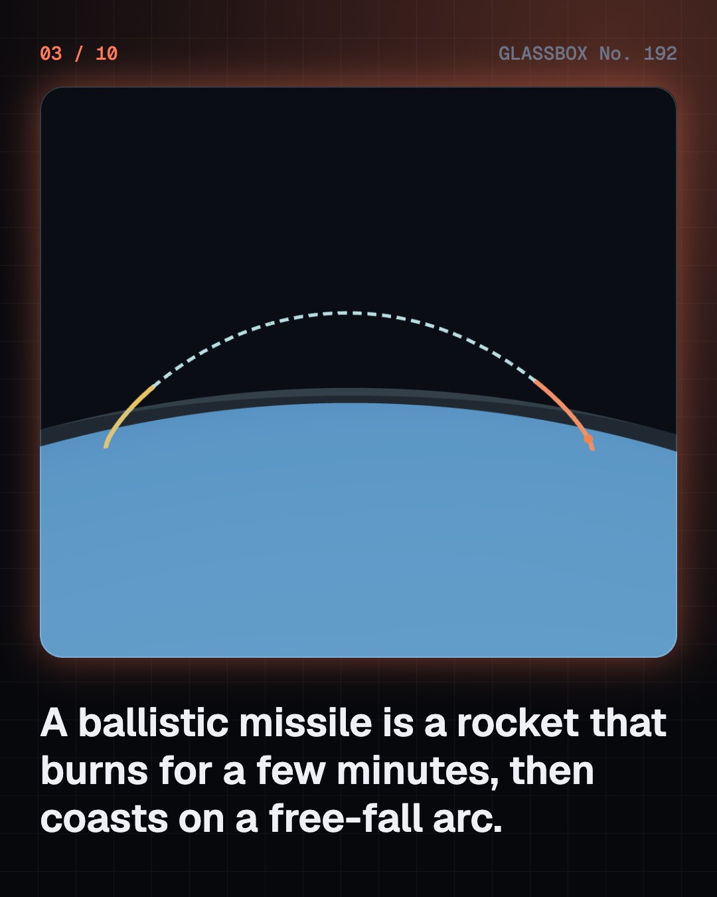
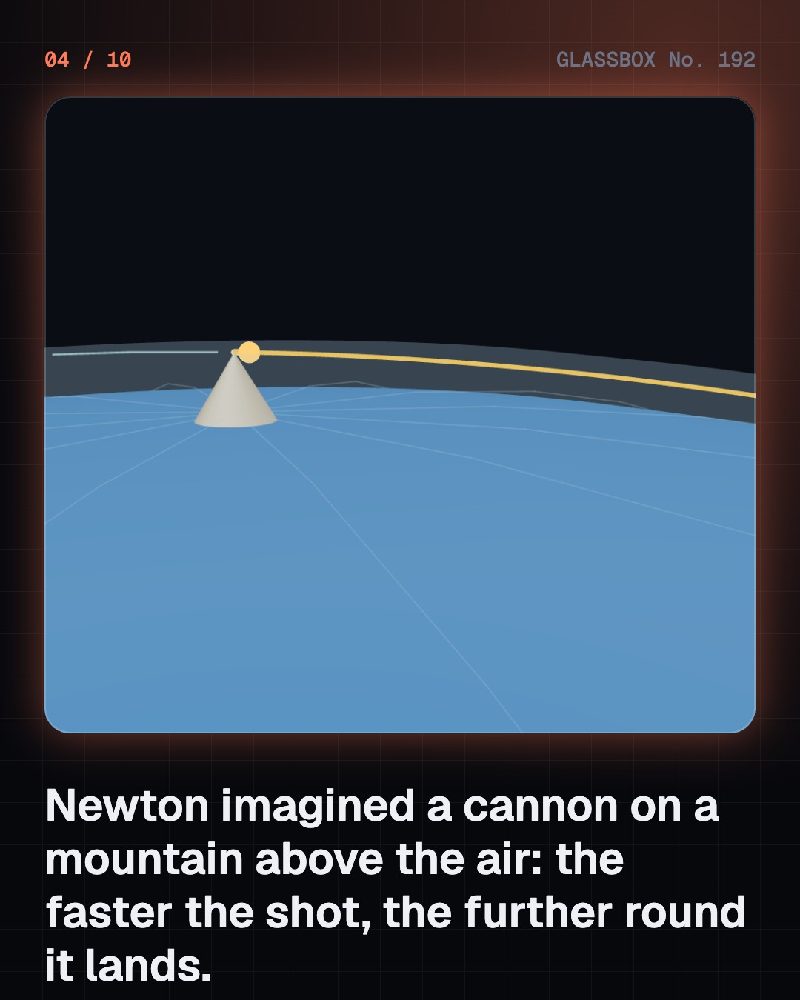

<!-- glassbox:start -->
<!-- Generated from glassbox.json by the Glassbox hub (npm run readme -- ballisticmissileclear). Edit glassbox.json, not this block. -->
<p align="center"><a href="https://glassbox.how/e/ballisticmissileclear/"></a></p>

<h1 align="center">BallisticMissileClear</h1>

<p align="center"><b>What is a ballistic missile?</b><br>A ballistic missile is a rocket that pushes for a few minutes and then simply falls, along the same kind of arc as a thrown ball. Fire Newton's cannon on a curved Earth and watch an arc close into an orbit.</p>

<p align="center"><a href="https://glassbox.how/ballisticmissileclear/"><b>▶ Play with it</b></a> &nbsp;·&nbsp; <a href="https://glassbox.how/e/ballisticmissileclear/">Read the 60-second explainer</a> &nbsp;·&nbsp; <a href="https://glassbox.how/ballisticmissileclear/glassbox/reel.mp4">Watch the 40-second video</a></p>

<p align="center">
  <a href="https://glassbox.how/e/ballisticmissileclear/"></a>
  <a href="https://glassbox.how/e/ballisticmissileclear/"></a>
  <a href="LICENSE"></a>
  <a href="LICENSE-CONTENT.md"></a>
  <a href="#privacy"></a>
</p>

## In 60 seconds

1. **One push, then free fall.** Ballistic means moving under gravity alone after a single push, like a thrown ball. A ballistic missile is a rocket whose engine burns only for the first few minutes; then it coasts on a free-fall arc and falls back into the air.
2. **Newton's cannon.** Newton imagined a cannon on a mountain above the air. Faster shots land further round the curve of the Earth. At about 7.9 km/s the ground curves away as fast as the ball falls, and it orbits. At about 11.2 km/s it escapes.
3. **Every arc is part of an ellipse.** A free-fall path around the Earth is a piece of an ellipse with the Earth's centre at one focus, the same shape Kepler found for planets. A short arc is the top of a long, thin ellipse that runs into the ground.
4. **Powered by rockets.** The push comes from a rocket built in stages that drop away when empty. Sounding rockets, satellite launchers and ballistic missiles all share this rocket physics; only the path differs.
5. **Names and ranges.** The Arms Control Association sorts ballistic missiles into short-range (under 1,000 km), medium-range (1,000 to 3,000 km), intermediate-range (3,000 to 5,500 km) and intercontinental (over 5,500 km). Cruise missiles are different: they fly like aircraft.
6. **The human cost and the treaties.** By the end of 1945 the atomic bombings had killed about 140,000 people in Hiroshima and 70,000 in Nagasaki. Since then the NPT, the INF Treaty, the MTCR, the CTBT and New START have tried to limit these weapons, with mixed success.

## Words worth knowing

| Term | Meaning |
|---|---|
| **Ballistic** | Moving under gravity alone after the push has ended, like a thrown ball or a cannon shell. |
| **Free fall** | Motion with only gravity acting. A thrown ball, a coasting rocket and an orbiting satellite are all in free fall. |
| **Boost, coast and re-entry** | The three phases of a ballistic flight: the engine burns, the rocket coasts on its arc, then it falls back into the air. |
| **Orbit speed** | About 7.9 km/s at the Earth's surface: fast enough sideways that the ground curves away as fast as you fall. |
| **Escape speed** | About 11.2 km/s from the Earth's surface: fast enough to leave the Earth for good. |
| **Ellipse** | A stretched circle. Every free-fall path round the Earth is part of one, with the Earth's centre at a focus. |
| **Re-entry heating** | The glow of air squeezed and heated in front of anything that falls back into the air very fast. |
| **Cruise missile** | A missile that flies like a small aircraft, held up by wings with its engine running all the way. |
| **Arms control** | Agreements between countries to limit, check or reduce weapons, such as the NPT and New START. |

## A short history

**Eight hundred years from Chinese fire arrows to Newton's cannon, the space race, and the treaties written in the shadow of Hiroshima.**

- **1232** · Fire arrows in China (Song and Jin armies (attributed), Kaifeng)
- **1687** · Newton's Principia (Isaac Newton, Cambridge)
- **1780** · Mysore's iron rockets (Hyder Ali and Tipu Sultan's armies, Mysore)
- **1944** · The V-2, built by prisoners (Nazi Germany, Mittelwerk, near Nordhausen)
- **1945** · Hiroshima and Nagasaki (United States (atomic bombs dropped from aircraft), Hiroshima and Nagasaki)
- **1957** · Sputnik and the space race (Soviet Union, Baikonur)
- **1962** · The Cuban Missile Crisis (United States and Soviet Union, Washington, Moscow and Cuba)
- **1963** · India's first rocket launch, Thumba (Vikram Sarabhai and team, Thumba, Kerala)

The full story, with 30 moments, charts, people and 37 sources: [glassbox.how/e/ballisticmissileclear/history](https://glassbox.how/e/ballisticmissileclear/history/). The data lives in [`history.json`](history.json).

## Video and slides

Made with the Glassbox studio from this box's storyboard (`window.glassbox.director`). Free to reuse under CC BY 4.0.

<a href="https://glassbox.how/ballisticmissileclear/glassbox/video.mp4"></a>

<p><a href="glassbox/slide-1.jpg"></a> <a href="glassbox/slide-2.jpg"></a> <a href="glassbox/slide-3.jpg"></a> <a href="glassbox/slide-4.jpg"></a></p>

| File | What | Size |
|---|---|---|
| [`glassbox/reel.mp4`](https://glassbox.how/ballisticmissileclear/glassbox/reel.mp4) | Reel / Short, with captions and soundtrack | 1080×1920 |
| [`glassbox/video.mp4`](https://glassbox.how/ballisticmissileclear/glassbox/video.mp4) | YouTube video, with captions and soundtrack | 1920×1080 |
| `glassbox/slide-1…10.jpg` | Instagram carousel | 1080×1350 |
| `glassbox/thumb.jpg` | YouTube thumbnail | 1280×720 |
| `glassbox/cover.jpg` | Share card and repo social preview | 1200×630 |
| [`glassbox/history-reel.mp4`](https://glassbox.how/ballisticmissileclear/glassbox/history-reel.mp4) | “History in 10 moments” Reel / Short | 1080×1920 |
| `glassbox/history-slide-*.jpg` | History carousel | 1080×1350 |
| `glassbox/post.json` | Post copy and schedule used by the publish kit | |

## Privacy

This box has no accounts and no ads, and it ships its own fonts and libraries. When you run it yourself it sends nothing anywhere. On glassbox.how, the site's `/bar.js` also loads Glassbox's analytics: **Google Analytics** to count visits (it asks first in the EU, UK and Switzerland, and stays off when your browser sends Global Privacy Control or Do Not Track) and **ClickTrust** to detect bots.

It remembers a few things **in your own browser only**, and never sends them anywhere:

| Browser storage key | What it holds |
|---|---|
| `ballisticmissileclear.v1` | Which chapters you have opened, your best quiz scores, and sound on or off. |

Exactly what each one sees is at [glassbox.how/privacy](https://glassbox.how/privacy/).

## Licences

- **Code:** [MIT](LICENSE). Use it, change it, ship it.
- **Explanations, text, images and videos** (`glassbox.json`, `glassbox/`): [CC BY 4.0](LICENSE-CONTENT.md). Credit “Glassbox, glassbox.how/e/ballisticmissileclear”.
- **Third-party parts** keep their own licences: [three.js](https://threejs.org) (MIT), [Geist, Instrument Serif](https://openfontlicense.org) (SIL OFL 1.1).
- The Glassbox name and logo aren't covered by either licence. See the [terms](https://glassbox.how/terms/).

Found a mistake? [Open an issue](https://github.com/bdeeps/ballisticmissileclear/issues). Corrections happen in public.
<!-- glassbox:end -->

## Run it

It's plain HTML, CSS and JavaScript. No build step and no dependencies. Run locally, it contacts no other website.

```bash
python3 -m http.server 8000
```

Three.js and the fonts ship in `vendor/` and `fonts/`, so it also works offline.

Then open http://localhost:8000.

## How it's built

| File | What |
|---|---|
| `index.html`, `css/app.css` | The page and its styles |
| `js/app.js`, `js/stage.js`, `js/ui.js`, `js/kit.js` | The shared Glassbox 3D engine: chapters, 3D stage, controls, quiz, video director |
| `js/chapters/*.js` | One file per chapter: the 3D model, controls, text, key terms, quiz and video scenes |
| `js/ballistic.js` | Shared physics and models: Newton's cannon in a vacuum (RK4 and the Kepler ellipse), the plain globe, the generic rocket, and screen-space lines |
| `glassbox.json` | Title, question, explainer beats, key terms, browser storage and credits shown on glassbox.how |
| `reel` in each chapter | The storyboard the Glassbox studio records into short videos |
| `glassbox/` | The published video, slides, thumbnail and post copy |
| `fonts/`, `vendor/three/` | Self-hosted Geist and Instrument Serif (SIL OFL 1.1) and three.js (MIT) |
